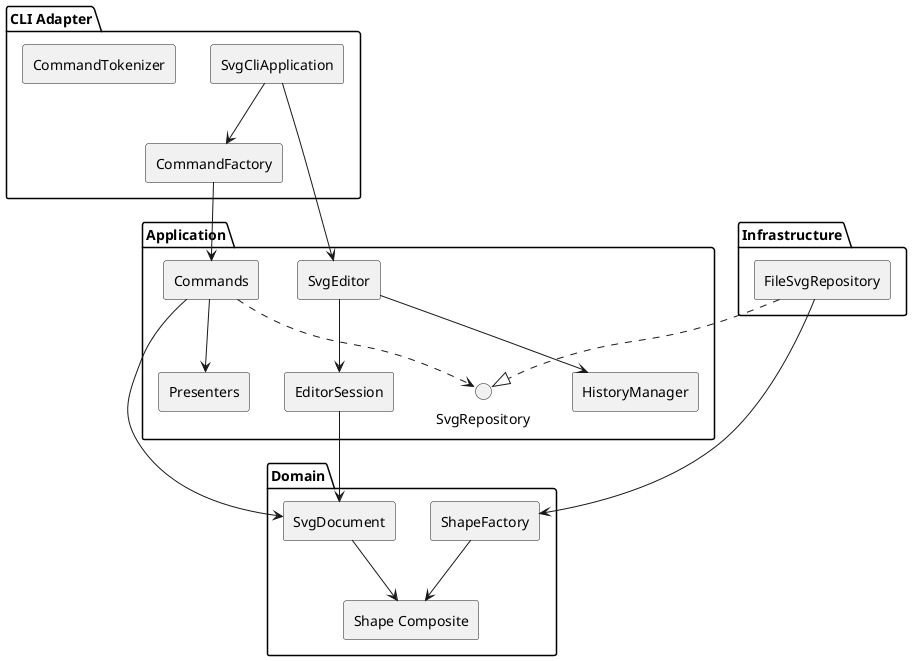

# SVG 编辑器 CLI 实验文档

## 架构方案

### 1. 模块划分

工程采用分层结构，领域对象不依赖命令行、文件系统或 XML 库。

| 模块 | 目录 | 职责 |
|---|---|---|
| 领域层 | `src/domain/` | 表达 SVG 文档、图形类层次、容器关系、全局 ID 和几何操作等核心规则 |
| 应用层 | `src/application/` | 编排 Command、undo/redo、编辑会话、查询渲染，并声明持久化端口 |
| 基础设施层 | `src/infrastructure/` | 用 DOM API 实现 SVG 文件读取、自动补 ID、序列化和原子写入 |
| CLI 适配层 | `src/cli/` | 解析命令行、分发命令、运行 REPL，并统一把异常转换为 `error:` 输出 |
| 测试 | `tests/` | 验证领域不变量、完整命令流程、错误路径和 SVG round-trip |



### 2. 设计模式的选择

#### Command（必选）

每条用户命令都实现 `EditorCommand`。可编辑命令继承
`SnapshotCommand`，把执行、撤销、重做和反馈封装在对象内；
`HistoryManager` 仅维护 undo/redo 栈，不了解具体图形操作。

- 一条编辑命令对应一个历史单元，`group` 等复合操作也只入栈一次。
- 命令执行前保存文档快照，异常时立即恢复，保证“失败不改变状态”。
- undo 后执行新编辑会清空 redo 栈。
- `init`、`read`、`save` 和修改尺寸的 `canvas` 设置历史屏障。

#### Composite

`Shape` 是统一抽象，`RectShape`、`CircleShape`、`EllipseShape`、
`LineShape`、`TextShape` 是叶子，`GroupShape` 是组合节点。
`move`、`scale`、`set`、`delete` 面向 `Shape` 操作；
其中容器通过递归把移动和缩放应用到全部子孙。

#### Factory

`ShapeFactory` 集中负责“类型名到图形类”的构造和 SVG 读回，
避免命令、文件适配器中出现 `switch(tag)`。`CommandFactory`
集中负责“命令名到 Command”的分派。

这两个映射是当前阶段仅有的按名分派点，也是已知待重构项：
后续插件化阶段应改为外部可注册的 `CommandProvider` 和
`ShapeProvider` 注册表，使新增命令或 `box` 类型不修改内核工厂。

#### Port and Adapter

应用层只依赖 `SvgRepository` 接口。`FileSvgRepository` 在外层
实现 XML 与文件 I/O，因此领域测试不需要真实文件，持久化实现也可替换。

### 3. 依赖方向规则

允许的依赖方向如下：

1. `domain` 不依赖工程内其他模块，也不依赖 XML、文件系统和 CLI。
2. `application` 可以依赖 `domain`，但不能依赖 `cli` 或 `infrastructure`。
3. `infrastructure` 可以依赖 `application/ports` 与 `domain`，以实现应用端口。
4. `cli` 是组合根，可以依赖 `application`、`domain` 和 `infrastructure`。
5. 测试可以依赖所有生产模块，生产代码不得反向依赖测试。

理由是让核心编辑规则独立于输入通道和存储方式。违反上述方向的 import
都视为待处理项；当前抽样检查未发现反向依赖。

### 4. 变化点假设

| 可能变化 | 已留出的设计 | 当前取舍 |
|---|---|---|
| 新增图形类型和复合图形 `box` | 图形多态、`ShapeFactory` 单一构造入口、SVG 额外属性保留 | Phase 1 不实现插件注册；工厂映射明确列为待重构 |
| 新增命令或 Agent/GUI 输入通道 | Command 与 CLI 解析分离，`SvgEditor` 接受命令对象 | 当前只提供 REPL；其他通道可复用应用层 |
| 替换存储介质或 XML 实现 | `SvgRepository` 端口隔离文件系统 | 当前只实现本地 SVG 文件适配器 |
| undo 数据量增长 | 历史策略封装在 `HistoryManager`/`SnapshotCommand` | 当前用全量快照换取原子性和正确性；大文档阶段再改为差量 Memento |
| 新增 SVG 标签或复杂文本 | XML 解析与领域构造分离，未知属性可 round-trip | 本阶段严格支持题目规定的六类元素，不提前实现完整 SVG 标准 |

## 过程记录

### 1. XML 读取方案修订

最初比较了手写 XML 解析和 DOM 解析两种方案。手写方案依赖字符串处理，
难以正确覆盖实体转义、命名空间和嵌套结构，因此改用
`@xmldom/xmldom`，并把它限制在基础设施层。首次安装还发现旧版本被上游
标记为存在严重问题，随后升级到 `0.9.12` 并重新执行安全审计。

### 2. undo/redo 粒度修订

逐命令编写逆操作复制量较少，但 `group`、`ungroup`、`addto` 涉及父节点、
顺序和整棵子树，逆操作容易漏状态。最终选择 Command + 文档快照：
具体命令仍负责业务行为和反馈，基类统一保证原子回滚。

### 3. 层级规则确认

实现过程中专门回放了“同时 group 容器及其后代”的例子。检查必须发生在
任何节点摘除之前，否则失败会留下部分修改。当前实现先完成全量校验和排序，
再一次性重组；测试验证错误后原树不变。

### 4. 质量门禁修订

第一轮测试全部通过，但分支覆盖率只有 72.57%，主要缺少各图形属性分支和
结构命令的 undo 分支。没有下调阈值，而是补充针对性测试，最终四项覆盖率
均超过 80%。

## 一致性自查

### 1. 模块划分

实际目录与方案一致：

- `src/domain`：图形类层次、工厂和文档聚合；
- `src/application`：命令、历史、会话、端口和展示；
- `src/infrastructure`：SVG 文件适配器；
- `src/cli`：分词、命令分发和 REPL；
- `tests`：领域、CLI、持久化测试。

实现期间没有出现需要改变既定模块边界的情况。

### 2. 依赖方向

已抽样检查生产代码 import：

- `domain` 没有导入 `application`、`infrastructure` 或 `cli`；
- `application` 仅导入 `domain` 和自身端口；
- XML/文件依赖只出现在 `infrastructure`；
- 对象组装只出现在 CLI 入口。

当前没有违反依赖方向规则的代码。两处按名分派均集中在工厂，并已作为后续
插件化阶段的待重构项记录。

## 质量保证手段

### 自动化检查

执行以下命令可完成全部门禁：

```bash
npm install
npm run check
```

`npm run check` 依次执行：

1. ESLint 类型感知静态检查；
2. TypeScript 严格模式编译；
3. Vitest 全量测试及 V8 覆盖率门禁。

最终结果为 3 个测试文件、14 个测试全部通过；覆盖率为：

| 指标 | 覆盖率 |
|---|---:|
| Statements | 94.48% |
| Branches | 82.09% |
| Functions | 95.07% |
| Lines | 94.45% |

测试覆盖六种图形、全部命令、Composite 递归操作、全局 ID、父子重组、
z-order、错误不改状态、undo/redo、I/O 屏障、自动补 ID、XML 实体转义、
额外属性保留和保存后读回。

### 手动验证

使用题目第 6 节的典型会话逐行回放，输出与要求一致；生成的 SVG 又通过
`read` 读回，元素数量、层级、几何属性和样式保持一致。

运行方式：

```bash
npm run cli
```
